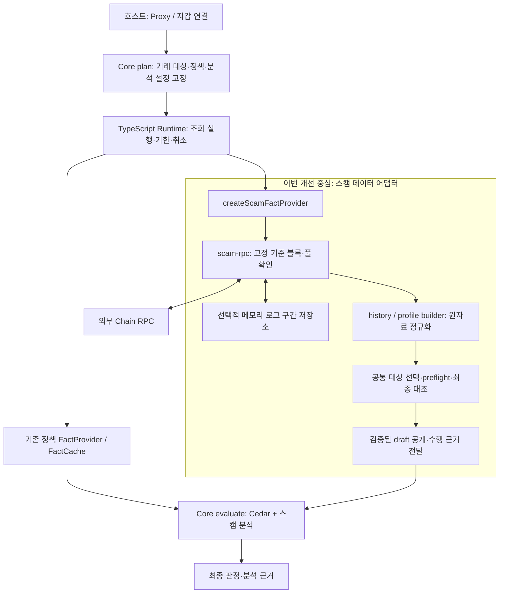

# 어댑터 이력 조회·검증 개선 세부 구현 계획서

상태: **설계안 v0.2 / AH1·AH2·AH4·AH5-1 완료, AH5-2 Node 연속 실측 확인·실제 호스트 확인 대기**. 작업 브랜치: `feat/adapter-history`. 출발 커밋: `07eb4f4` — SF4-5 provider 통합·진단 checkpoint. 날짜별 일정 대신 변경 계약, 구현 순서, 완료 기준을 정의한다.

이 문서는 **과거 로그를 가져오는 어댑터의 첫 조회·반복 조회 비용을 줄이는 코드 구현 계획**이다. [기존 어댑터 계획](adapter-development-plan.md)의 후속이며, [Scam Filter 계획](../scam-filter/mvp-design-plan.md)의 SF4-5에서 분리한 작업이다. 조사 근거는 [어댑터 이력 검증 개선안](</Users/spu/SDKdambi/reports/어댑터 이력 검증 개선안.md>)에 있다. 원격 자료의 변경이 이 계획의 계약을 자동으로 바꾸지는 않는다.

사용자 확정 목표는 **사전 준비를 허용한 서명 직전 2.5초**다. 준비 시간과 새 기준에서 검사하는 시간을 분리하며, 첫 cold 조회를 2.5초 안에 끝냈다고 해석하지 않는다. 알고리즘을 제외한 어댑터 실측이 전체 서명 검사 성능을 증명하지는 않는다.

## 1. 해결할 문제와 판단 근거

현재 로그 시각을 활용해도 **수집한 모든 이벤트 블록을 마지막에 다시 조회하는 비용**이 남는다. 최신 사용자 실행의 상세 결과는 [SDK 검증 기록](../../fixtures/sdk/README.md#sf4-5-sdk-통합데이터-경로-측정)에만 유지한다. 구조적 병목은 로그 시각 확보가 아니라 `scam-rpc.ts`의 전수 최종 대조다.

| 설계 판단 | 선택 | 이유·한계 |
| --- | --- | --- |
| 첫 수정 | 근거 수집과 최종 대조 대상 선택 분리 | preflight와 실제 실행의 대상을 일치시킨다. 이 단계만으로 요청 수가 줄지는 않는다 |
| 첫 조회 비용 | 명시적으로 선택하는 `rpc_anchor` 추가 | 로그 때문에만 생긴 헤더 재조회를 줄인다. 개별 로그와 헤더의 교차 대조 범위가 줄어든다 |
| 기존 소비자 | `all_event_headers` 기본값 유지 | 오류·예산 부족 때문에 검증 방식을 자동으로 약화하지 않는다 |
| 상태값 결속 | 선택적 EIP-1898 지원 | 상태 조회를 실제 블록 해시에 묶는다. 범위 로그의 완전성을 증명하지는 않는다 |
| 반복 조회 비용 | 완료된 원자료 로그 구간 재사용 | 새 기준 블록에서 필요한 차집합만 가져온다. 과거 Fact를 새 분석 결과로 재사용하지 않는다 |
| 첫 저장소 | source 인스턴스 내부의 제한된 메모리 저장소 | 별도 노드·DB·공개 저장소 플러그인 없이 구현한다. 프로세스·확장 worker 재시작 시 사라진다 |

**두 모드 모두 같은 RPC 응답의 정합성을 검사하는 방식이다.** 합의 검증, 영수증 포함 증명, 로그 누락 없음의 독립 증명이 아니다. `rpc_anchor`를 기존 전수 대조와 같은 보장이라고 표현하지 않는다. 현재 측정에서 가능한 요청 감소 추정은 실제 성능 결과가 아니며, 2.5초 목표 달성을 미리 약속하지 않는다.

## 2. SDK 안에서 수정하는 위치



RPC를 호출하는 곳은 TypeScript 어댑터다. Rust Core에 RPC 호출을 넣지 않는다. 다만 새 근거를 전달하기 위한 **SDK wrapper 타입·Rust 파싱·결과 binding**은 함께 수정한다. 기존 일반 FactCache와 이번 원자료 저장소는 별개다.

| 파일·영역 | 수정 내용 |
| --- | --- |
| `packages/core/src/adapters/scam-rpc.ts` | 근거 역할 구분, 최종 대상 선택, 동일 대상의 비용 계산·검증, 상태 selector, 구간 재사용 연결 |
| `scam-block-time.ts`, `scam-rpc-codec.ts` | 로그 시각과 실제 헤더 출처 구분, 충돌 검사 유지 |
| `scam-pool-history.ts`, `scam-token-profile.ts` | 근거 연결 및 새 기준에서 재구성. 산식·지원 범위 유지 |
| `scam-fact-provider.ts`, `adapters/index.ts` | 불변 설정, 공개 설정 타입, 실제 수행 근거·계측 연결 |
| `packages/core/src/types/scam.ts` | typed verification provenance와 결과 binding 확장 |
| `crates/dambi-core/src/session/scam.rs`, `scam/types.rs`, 관련 검증부 | 엄격 파싱·두 입력의 공통 근거 대조·결과 보존 |
| 신규 `scam-history-store.ts` | AH4에서만 추가하는 내부 구간 저장·차집합·상한·무효화 모듈 |
| `scripts/sdk/scam-data-probe.mjs`, 기존 어댑터·SDK 시험 | 모드·재사용별 비용 측정과 영향 범위 회귀 |

별도 알고리즘 구현, R1/R2·event_count 계산 변경, Cedar 정책 변경, 설정 화면, 꼬리/EAS, 온체인 레지스트리, 자체 노드·인덱서는 이번 범위에 포함하지 않는다. 기존 `portfolio.balance` 등 다른 어댑터에 새 모드를 일괄 적용하지 않는다.

## 3. 유지할 계약

- 관측 기간 24시간·warm-up 1시간·10초/60초 후보 그리드를 숨겨서 축소하지 않는다. seed·gap·0 처리·풀 나이 기준과 관리자 이벤트 지원 범위를 유지한다.
- 실제 pool/factory 검증, 주소·토픽·범위·ABI·동일 위치의 상충 로그 검사를 유지한다. 조회 실패와 성공한 빈 구간을 구분한다.
- 하나의 reference group에서 history/profile은 같은 기준 블록을 사용한다. 새 T의 분석에는 새 T의 Fact를 만든다.
- 개별·누적 응답 바이트, 요청·로그·포인트·작업 기한 상한을 유지한다. 캐시 hit도 처리할 로그·메모리 한도에 포함한다.
- 필요한 최종 검사 전에 FactBatch를 공개하지 않는다. 취소·만료·reorg·자원 초과는 명시적인 실패로 남긴다.
- 기존 정책 `deny`·`warn`과 취소 계약을 보존한다. 데이터 실패를 `quiet`, 0, 정상 빈 이력으로 바꾸지 않는다.
- 현재 source의 요청 간격·cooldown은 배치 간 공유한다. HTTP concurrency는 현재 배치 단위이므로 전체 프로세스의 전역 동시성 보장으로 설명하지 않는다.

## 4. 검증 방식과 근거 전달 계약

### 4.1 독립적으로 선택하는 두 설정

```ts
type HistoryVerification = "all_event_headers" | "rpc_anchor";
type StateBinding = "number_recheck" | "block_hash_canonical";
```

기본값은 기존 동작인 `all_event_headers` + `number_recheck`다. 구간 재사용은 기본 비활성이다. 옵션은 `ScamRpcOptions.verification`의 `history`·`stateBinding`으로 받는다. AH2부터 `rpc_anchor`를 선택할 수 있으며, `block_hash_canonical`은 AH3 구현 전까지 `invalid_config`로 거부한다.

| 검사 | all_event_headers | rpc_anchor |
| --- | --- | --- |
| 수집한 로그의 형식·scope·충돌·시간 순서 | 유지 | 유지 |
| 각 이벤트 블록의 헤더 재조회 | 수행 | 로그 때문에만 추가된 블록은 생략 |
| checked head·분석 기준 블록 | 최종 대조 | 최종 대조 |
| 실제 조회한 과거 헤더·상태 조회 기준·캐시 구간 경계 | 최종 대조 | 최종 대조 |
| 시각 없는 로그의 시각 확보 | 실제 헤더 조회 | 실제 헤더 조회 |
| 올바른 해시를 붙인 잘못된 로그 본문·누락의 독립 검증 | 제공하지 않음 | 제공하지 않음 |

`rpc_anchor`에서도 시각 누락·경계 탐색에 실제 헤더가 필요하면 비용이 늘어난다. **모든 환경에서 O(1) RPC가 된다는 완료 조건은 두지 않는다.** 과거 backend 로그가 기준점 응답과 다른 분기에서 나왔어도 개별 대조를 생략하면 놓칠 수 있다는 한계를 유지한다.

설정은 provider/source 생성 시 검증·복사해 불변으로 소유하고, 한 fetch의 모든 그룹에 동일하게 적용한다. 변경하려면 새 provider를 만든다. 실패 후 모드 전환, 숫자/`latest` fallback은 없다.

이번 범위의 고정은 **호스트가 선택한 provider의 실행 계약 고정**이다. Core `plan()`이 별도 검증 정책을 요구·강제하는 새 기능은 추가하지 않는다. 이미 고정되는 분석 룰·번들·알고리즘 계약과 구분한다. 향후 정책별 최소 검증 수준을 강제하려면 Config→Plan→call params→결과 대조를 별도로 연결해야 한다.

### 4.2 전체 근거와 최종 대조 목록 분리

블록별 근거를 하나의 Map에 유지하되 역할 집합을 둔다: `checked_head`, `reference`, `queried_header`, `state_read`, `log`, `cache_boundary`. 한 블록이 여러 역할이면 합친다. 로그와 헤더의 해시·시각 충돌 검사는 역할과 관계없이 수행한다.

1. `selectFinalChecks(evidence, verification, pendingHeaders)`가 유일한 대상 선택 함수가 된다.
2. 기존 모드는 모든 관측 근거를 선택한다. anchor 모드는 `log` 역할만 있는 근거를 제외한다. 실제 읽은 헤더는 계속 대조한다.
3. preflight는 같은 선택 함수로 추가 시각 헤더·최종 대조·남은 pacing의 알려진 하한을 계산한다. 앞으로 읽을 헤더도 최종 검사 대상이 된다는 비용을 포함한다.
4. 수집 중 근거가 늘면 해당 지점에서 재계산하고, 수집 종료 시 최종 목록을 확정한다. 중간 preflight를 전체 완료 예측으로 표시하지 않는다.
5. 최종 목록은 높이 중복을 제거하고 기준 블록을 마지막에 대조한다. 최종 검사 중 새 근거가 생기는 설계는 피한다.
6. 최종 검사·시간 순서·취소·기한 확인 후에만 draft를 공개한다.

### 4.3 TypeScript → Rust → 결과에 실제 보장 남기기

현재 Rust wrapper는 `deny_unknown_fields`를 사용하고, 결과의 `AnalysisBinding`을 새로 만든다. 어댑터에 JSON 필드만 추가하거나 metrics에만 기록해서는 충분하지 않다.

최소 확장은 **버전 1인 typed `verification` metadata**를 `MethodValueMeta`와 결과 binding에 추가하는 것이다. 내용은 선택 모드·실제 state binding, `header`/`rpc_log` 시간 출처, 재사용 여부·원자료 최초 관측 범위·현재 재확인 시각이다. 공통 설정과 메서드별 근거를 구분하고, 원본 로그 전체나 endpoint·인증값은 결과에 넣지 않는다. 최종 대조 요청 수 같은 성능 상세는 metrics에 둔다.

- 내장 provider의 새 응답에는 실제 수행한 metadata를 항상 넣는다. 두 메서드의 공통 모드·결속 방식·기준 블록은 일치해야 하며 메서드별 시간 출처나 재사용량은 달라도 된다.
- Rust는 enum·버전·시각·공통 결속을 검증하고 분석 결과에 보존한다. provider의 주장을 암호학적으로 인증했다고 표현하지 않는다.
- 기존 사용자 provider/fixture의 metadata 누락은 호환용 `legacy_unspecified` 의미로 취급한다. 누락만으로 전수 대조 완료를 추정하지 않는다. 불완전하거나 알 수 없는 새 metadata는 거부한다.
- 구형 Core는 새 필드를 거절할 수 있으므로 TypeScript·Rust·WASM을 함께 배포한다. 이를 구형 WASM과도 호환되는 무조건적 추가 필드라고 설명하지 않는다.
- 순수 알고리즘 입력·출력의 `contractVersion: 1`, `scam.pool_history/1`·`scam.token_profile/1` 산식은 유지한다. 이번 근거 확장은 SDK wrapper의 계약이다. 정규화 의미가 그대로면 이름만 바꾸기 위해 builder 버전을 올리지 않는다.
- 결과·입력 크기 상한에는 새 metadata를 포함한다. stub/실제 알고리즘 여부와 데이터 검증 모드는 별개로 보존한다.

## 5. 해시로 상태 조회 고정하기

`block_hash_canonical`을 선택한 경우 `eth_call`과 `eth_getCode`에 `{ blockHash, requireCanonical: true }`를 사용한다. getReserves뿐 아니라 pool identity, factory.getPair, decimals도 대상이다. 과거 seed·나이 하한 조회는 각각 **그 과거 블록의 해시**를 사용한다.

이 기능은 GIWA endpoint에서 관련 메서드의 지원을 확인한 뒤 실연결에 활성화한다. 검증 명령은 제공하고 실제 실행은 사용자가 한다. 정상 hash selector 수용 여부와 잘못된 해시 거절을 확인하되, 실제 reorg 없이 `requireCanonical` 의미 전체가 실증됐다고 주장하지 않는다. canonical 오류 분기는 합성 시험으로 검증한다.

미지원·canonical 오류·일반 RPC 장애는 진단에서 구분하고 선택한 모드의 실패로 처리한다. `number_recheck`는 명시적인 별도 선택으로 계속 지원한다. **EIP-1898 실연결 확인은 `rpc_anchor + number_recheck`의 구현·측정을 막지 않는다.** 또한 이 변경은 범위 `eth_getLogs`를 한 블록 해시에 결속시키지 않는다.

## 6. 원자료 구간 재사용

### 6.1 최소 구현 범위

AH2 실측 후 사용자가 사전 준비를 허용하여 AH4를 진행한다. `rpc.historyCache`를 명시한 경우에만 `createScamRpcSource()` 인스턴스 내부에 저장소를 두고, 같은 provider를 재사용한 경우에만 hit가 발생한다. **완료된 정규화 원자료 로그 구간**을 저장하며 Fact·분석 결과·grid·getReserves·getCode·decimals는 저장하지 않는다.

- key: source 인스턴스, chain, 검증한 pool/factory 및 대상 token, scope·조회 주소·정규화한 topic 필터, codec·검증 설정 버전. source가 달라지면 공유하지 않는다.
- value: inclusive 블록 범위, 실제 시작·끝 헤더, 로그의 hash/time과 출처, 최초 수집 시각, 수집 시 검증 방식, 완료 표시.
- 선택 설정에 `maxBytes`, `maxEntries`, 보관 블록 범위와 TTL 상한을 명시한다. 항목 전체 단위로 퇴출하고, 큰 항목은 저장을 생략한다. 저장 공간 부족만으로 정상 조회를 실패시키지 않는다.
- 구간 자료와 완료 표시는 하나의 항목으로 원자적으로 반영한다. 완료된 빈 구간도 유효하다. 실패·누락 범위는 완료로 저장하지 않는다. 첫 구현은 `missing=[]`인 완료 scan만 저장한다.
- 첫 구현은 key마다 최신 완료 scan 하나를 보관한다. 전체가 재사용된 요청은 원래 구간·TTL을 유지한다. 새 구간을 합쳐 저장할 때만 보관 시각이 갱신되며 원자료 최초 관측 시각은 보존된다. 저장소 바이트 상한은 소유 JSON의 UTF-8 크기이며 JS 힙 전체의 추정치가 아니다.

### 6.2 새 기준 블록에서 사용하는 순서

1. 새 T와 checked head를 고정하고 pool identity를 확인한다.
2. 필요한 블록 범위와 저장된 완료 범위의 교집합을 찾는다. 저장 단위의 끝이 T보다 뒤인 자료는 첫 구현에서 재사용하지 않는다.
3. 교집합은 원래 저장 단위의 경계 근거를 유지한다. 부족한 차집합만 기존 최대 10,000블록 이하의 inclusive 요청으로 가져온다.
4. 저장 자료와 새 자료를 기존 정렬·중복 충돌 검사로 합친다. 성공한 빈 구간과 미수집 구간을 구분한다.
5. 새 분석의 경계·seed·profile 상태를 조회하고 기존 builder로 새 T의 snapshot을 만든다. 과거 Fact의 reference를 바꿔 붙이지 않는다.
6. 캐시 경계·새 근거를 포함한 같은 final selector로 preflight와 최종 검사를 수행한다.
7. 저장 후보 복사·크기 계산은 최종 검사 전에 수행하고, `withBatch`의 검증·취소·기한 확인이 모두 끝난 뒤 동기 commit한다. 같은 provider fetch의 뒤쪽 그룹이나 결과 포장이 실패해도 앞서 독립 검증을 마친 원자료는 남길 수 있다. **provider의 부분 FactBatch 반환은 계속 금지**한다.

새 Fact의 `observedAt`은 이번 조회·검증의 시작 시각이며 원자료 최초 수집 시각은 metadata에 별도로 보존한다. cache hit로 원자료의 나이를 덮어쓰거나 TTL만으로 체인 정합성을 주장하지 않는다.

### 6.3 모드별 재확인과 무효화

| 경우 | 처리 |
| --- | --- |
| all_event_headers의 cache hit | 캐시 로그도 현재 evidence에 넣고 이벤트 블록 전수 재대조. 로그 다운로드는 줄지만 헤더 비용은 남음 |
| rpc_anchor의 cache hit | 저장 구간 시작·끝 실제 헤더와 새 기준점 대조. 개별 로그 대조 생략이라는 신뢰 가정 유지 |
| 경계 hash 변경·같은 높이 상충 | source 저장소 전체 무효화, 현재 batch는 reorg 실패, 다음 호출에서 cold 재수집 |
| 확인된 head 역행 | 무효화 후 현재 batch 실패. 늦게 도착한 이전 요청을 역행으로 잘못 판단하지 않도록 요청 순서와 기준 획득 시점을 구분 |
| source·mode·codec 변경, TTL 만료·용량 초과 | 다른 인스턴스/키 또는 miss·퇴출. 오래된 수준을 새 수준으로 승격하지 않음 |
| 시간 초과·취소·검증 실패 | 해당 batch의 새 draft 미저장, Fact 미공개 |

source에 무효화 세대 번호(generation)를 두고 각 batch가 시작 시 이를 고정한다. 최종 공개·저장 직전에 세대가 같은지 확인하며 달라졌으면 `reorg`로 실패시킨다. 이전 세대 batch의 늦은 재삽입뿐 아니라 이미 읽은 캐시로 만든 결과의 공개도 금지한다. 첫 버전은 진행 중 요청을 공유하는 single-flight를 넣지 않고 caller별 취소·기한을 독립 유지한다. 완료된 불변 entry만 공유한다.

부분 헤더만으로 연속 부모 체인을 검증했다고 말하지 않는다. 공통 조상 탐색·깊은 reorg 부분 rollback·safe/finalized 최적화는 후속이다. `confirmDepth: 2`를 finalized와 동일시하지 않는다. IndexedDB·외부 인덱서는 이번 범위에 넣지 않는다.

### 6.4 서명 전 준비와 검사

`createScamFactProvider()`의 `prepare(calls, { planId, timeoutMs, signal? })`는 캐시 설정이 있는 provider에서만 동작한다. 호스트가 사전에 준비할 스캠 대상의 paired calls를 전달하며, 1~60,000ms의 별도 준비 예산을 명시한다. 기존 데이터 경로를 실행하되 계산한 Fact는 반환하지 않는다. 준비의 판정이나 만료된 Core plan을 서명에 재사용하지 않는다.

서명 시에는 새 plan의 calls를 동일 provider의 기존 `fetch()`/Core `check()` 경로에서 처리한다. `limits.timeoutMs`는 여전히 2,500ms이며 최신 기준·seed·상태를 다시 읽고 원자료의 차집합을 채운다. 캐시 만료·worker 재시작·미준비 대상은 cold 경로가 될 수 있고, 제한 시간 안에 못 끝나면 명시적인 판정 불가로 남긴다. 자동으로 검증·기간·로그 상한을 낮추지 않는다. 호스트 UI 연결은 후속 통합 범위다.

결과 크기 검사는 공통 JSON 검증 순회를 복사 없이 수행하고 마지막 metadata 포함 바이트 수를 재사용한다. getter·Unicode·순환·깊이·조기 크기 제한은 유지한다.

## 7. 단계별 구현·완료 기준

번호는 진행 경계다. 소단계마다 별도 커밋·전체 빌드·보고서를 요구하지 않는다. 테스트 코드는 변경과 함께 작성하고 실행 명령을 제공하며, 사용자의 실행 결과로 완료 상태를 갱신한다.

| 단계 | 작업 | 완료 기준 | 현재 상태 |
| --- | --- | --- | --- |
| **AH1-1 계약·근거 연결** | §4 설정과 SDK metadata, Rust 파싱·binding, legacy 호환 의미 고정 | 잘못된·불일치 metadata 거부, 실제 근거가 verdict까지 보존; 알고리즘 wire 의미 유지 | 완료 — 사용자 실행 결과 확인 |
| **AH1-2 최종 검증 분리** | 역할별 evidence, 공통 selector·preflight·finalizer | 기본 모드에서 기존 대상·결과 동일, 실제 선택과 비용 일치 | 완료 — 사용자 실행 결과 확인 |
| **AH2 RPC 신뢰 모드** | 명시적 rpc_anchor, 계측·probe 옵션 | 시간 제공 로그가 늘어도 로그 전용 final 요청은 증가하지 않음; 남겨야 할 검사·실패 격리 유지 | 완료 — 사용자 시험 통과·첫 cold 조회 partial 확인 |
| **AH3 해시 상태 결속** | 모든 상태 selector 공통화, EIP-1898 선택 지원 | 메서드별 블록 해시 정확, 오류 fallback 없음; 실연결 지원은 별도 확인 | 미착수 / AH2와 독립 가능한 후속 |
| **AH4-1 구간 저장·차집합** | bounded memory store, 완료·빈 구간·필터 분리, prepare API | 같은 T/증가한 T에서 필요한 누락 구간만 조회, 새 Fact 재구성 | 완료 — 사용자 시험·준비 후 단발 조회 확인 |
| **AH4-2 재확인·무효화** | 모드별 cache evidence, generation·원자적 저장 | reorg·취소·늦은 응답으로 자료/결과 오염 없음, 상한 유지 | 완료 — 사용자 회귀 시험 통과 |
| **AH5-1 SDK 통합** | 준비 후 manual evaluate/check 및 정책·수명주기 회귀, 전체 check 시간 측정 | 두 진입점의 근거 일치, 기존 deny/warn·실패 이유 보존, 임시 알고리즘과 실제 성능 구분 | 완료 — 사용자 측정·SDK 통합 시험 통과 |
| **AH5-2 실측·SF4-5 인계** | cold/동일 T/증분 비교, 실제 사용 호스트 확인 | 데이터 완료·부분·실패와 비용 구분, 제품 목표 충족 여부 명시 | 진행 중 — Node 연속 실측 확인·확장 SW 확인 대기 |

현재 실행 순서는 **AH1 → AH2 → 첫 cold 진단 → AH4·사전 준비 → AH5**다. 사용자 확정 목표에 따라 AH4를 진행하며, AH3는 별도 후속으로 남긴다. AH3의 endpoint 지원 대기는 구간 재사용과 준비 후 2,500ms 데이터 경로 측정을 막지 않는다.

AH2 모드를 구현하는 것과 제품에서 기본 활성화하는 것은 별개다. 이 계획은 **선택 기능 제공**을 권장하며 기존 기본값은 바꾸지 않는다. 제품에서 사용할 검증 수준은 실측 결과와 보장 차이를 확인한 뒤 확정한다.

## 8. 필요한 시험과 비용 측정

### 8.1 변경에 직접 연결되는 시험

| 변경 | 필수 확인 |
| --- | --- |
| finalizer | preflight/실행 대상 일치, 같은 높이 역할 합치기, 기준 블록 마지막 확인, profile 수집 후 늘어난 근거 포함 |
| 모드 | 기본 모드의 개별 hash/time 불일치 거부, anchor 모드의 기준점 변경 거부·로그 전용 대조 생략을 명시한 사례, timestamp 누락 시 헤더 경로 |
| 상태 결속 | identity·decimals·현재/과거 reserves·code의 정확한 selector, 미지원/canonical 오류, 숫자/latest 무음 fallback 없음 |
| SDK 계약 | legacy 누락 처리, 잘못된 enum/버전·두 메서드 불일치 거부, TS→Rust/WASM→binding 보존, 크기 상한 |
| 구간 저장 | 빈 완료/실패 구별, 필터 분리·중복 충돌, 부분 교집합, 새 T·seed, 모드별 재확인, 동시 batch 무효화 후 이전 draft 공개·저장 금지, 취소·퇴출·hit의 로그 한도 |
| 통합 | 기존 정책 결과 유지, 전체 기한·dispose, 최종 검증 전 미공개, manual/check 근거 일치 |

기존 통과 사례는 관련 코드가 바뀔 때만 다시 실행한다. 어댑터 내부 변경만이면 TypeScript·해당 Node 시험으로 한정한다. Rust wrapper가 바뀌는 AH1-1에서는 관련 Rust 시험과 Native/WASM 통합이 필요하다. 문서만 바꿀 때 빌드·시험하지 않는다. 알고리즘 팀의 계산 시험을 복제하지 않는다.

### 8.2 기존 probe 확장

새 벤치마크 시스템을 만들지 않고 `scam-data-probe.mjs`를 확장한다. 모드, 실제 state binding, cache off/on, 최종 선택 블록 수, preflight의 남은 헤더 조회 수, 실제 재사용 여부·기준 블록 변화, 기존 요청·재시도·바이트·실패 원인을 출력한다. 최초 수집과 이번 재확인 시각은 구분하되 raw 로그·비밀 endpoint는 출력하지 않는다. 정확한 재사용/새 조회 블록 범위와 누적 시각 fallback 요청 수는 현재 미계측이며, 최종 preflight나 청크 수로 추정하지 않는다.

| 측정 | 조건·판단 |
| --- | --- |
| cold | 새 source 또는 cache off, 기존 기간·그리드·자원 상한 유지. 두 모드의 비용과 실패 비교 |
| 동일 T 재사용 | 같은 source와 실제 같은 reference로 실행. 합성 시험에서는 결정적으로 고정; live에서 다른 T면 동일 T hit로 집계하지 않음 |
| 증분 | 같은 source에서 T가 증가했음을 확인. 미수집 구간과 필요한 재확인 비용을 구분 |
| 제품 시간 예산 | 진단용 60초와 기존 2,500ms를 별도로 평가. 시간 한도를 늘린 결과를 제품 성능 통과로 취급하지 않음 |
| 실패·부분 완료 | 성공 지연과 함께 전체 시도 대비 timeout·failure·partial 비율 표시. 미지원 age/admin을 완전 성공으로 바꾸지 않음 |

처음에는 비교 가능한 단발 진단으로 실제 완료 경로부터 확인한다. 미완료 원인이 남아 있으면 같은 설정의 반복 수만 늘리지 않는다. 완료 후 필요한 표본을 모아 p50/p95와 실패율을 함께 보되 소표본의 p95를 SLA로 선언하지 않는다. 분석 알고리즘을 제외한 provider 시간과 SF6의 전체 분석 시간을 구분한다.

Node RPC 성공만으로 브라우저 확장 실행까지 통과했다고 하지 않는다. 기존 SF0-2 접근성 확인을 이유 없이 반복하지 않되, 새 selector·메모리 재사용·worker 재시작 동작은 실제 소비 호스트에서 필요한 범위만 확인한다.

전체 SDK 시간은 호스트 예제의 `checkWithTiming()`으로 `core.check()` 호출 직전부터 판정 반환·거절까지 측정한다. plan·정책/스캠 Fact 조회·평가·동기 알림을 포함하고, 초기화·사전 준비·비동기 알림·화면 렌더링은 제외한다. 기존 provider probe의 시간 의미는 바꾸지 않는다. 측정값은 실제 `analysisMode`와 평가 상태를 함께 남기며 `withinBudget`는 지연 비교일 뿐 완전한 분석 성공을 뜻하지 않는다. 이 계측은 기존 timeout 계약이나 전체 검사 deadline을 새로 강제하지 않는다. 임시 알고리즘·합성 RPC로 연결 동작을 확인한 뒤 실제 알고리즘과 사용 호스트에서 전체 목표를 판정한다.

## 9. 완료 판정과 기록

완료는 세 수준으로 구분한다.

1. **어댑터 코드 완료:** 선택 모드·근거 전달·필요한 재사용 구현과 영향 범위 시험 통과.
2. **데이터 경로 검증:** 실제 대상에서 결과를 만들고 coverage와 실패 사유를 정확히 전달. 미지원 capability가 있으면 부분 완료로 기록.
3. **제품 성능 적합:** 합의한 검증 모드·실제 사용 환경·시간 예산에서 지연과 판정 불가 비율을 만족. 실제 알고리즘을 포함한 최종 전체 성능은 원래 계획의 SF6에서 판정한다.

SF4-5 재개·완료는 1·2의 데이터 연결과 비용·지원 제한 확인을 기준으로 원래 계획에서 판단한다. 데이터 경로가 resource_limit로 중단되는 상태를 통과로 표시하지 않으며, 데이터 완료만 확인한 상태를 전체 분석 성능 통과로 확대하지 않는다.

AH1만 끝나면 검증 구조 정리 완료이며 성능 개선 완료가 아니다. AH2로 cold 경로가 완성돼도 2.5초를 넘을 수 있다. 이 경우 AH4·호스트 준비 경로·데이터 공급 경로 중 필요한 후속을 실측으로 결정한다. 실패를 감추기 위한 기간 축소·로그 절단·기본 검증 완화는 하지 않는다.

결과는 `fixtures/sdk/README.md`의 이 작업 구역 한 곳에 **검증한 변경 범위/커밋, 통과·실패, 남은 문제**만 짧게 기록한다. 이 계획서는 위 단계 상태만 갱신하고 기존 스캠 계획에는 SF4-5 재개 상태와 이 문서 링크만 남긴다. coverage 문서는 실제 지원 범위·제한이 바뀔 때만 갱신한다. 커밋·푸시는 사용자 요청에 따른다.

## 10. 채택한 조사 근거

아래는 기존 조사에서 확인한 설계 근거다. 이번 계획 작성에서 새로운 live RPC 검증을 수행한 것은 아니다.

- [viem getLogs 구현](https://github.com/wevm/viem/blob/main/src/actions/public/getLogs.ts): 로그 조회 자체와 클라이언트의 추가 헤더 검증을 구분하는 참고.
- [Ponder 이력 수집](https://github.com/ponder-sh/ponder/blob/main/packages/core/src/sync-historical/index.ts), [구간 저장](https://github.com/ponder-sh/ponder/blob/main/packages/core/src/runtime/historical.ts): 원자료와 완료 구간 재사용. 최초 헤더 검증 비용이 없다는 근거로 사용하지 않는다.
- [EIP-1898](https://eips.ethereum.org/EIPS/eip-1898), [EIP-234](https://eips.ethereum.org/EIPS/eip-234): 상태값 해시 결속과 단일 블록 로그 조회의 범위 차이.
- [GIWA 확정 단계](https://docs.giwa.io/giwa-chain/en/network-information/diffs-ethereum-giwa): 확인 깊이와 safe/finalized를 구분하는 근거. endpoint의 실제 지원은 별도 측정.

vChain·FlyClient의 암호학적 증명 시스템, Multicall, 무작위 헤더 표본검사, 무조건적인 병렬도 증가는 이번 최종 대조 루프의 직접 대체로 채택하지 않는다. 상세 비교는 기존 조사 보고서에 두고 여기서 반복하지 않는다.
